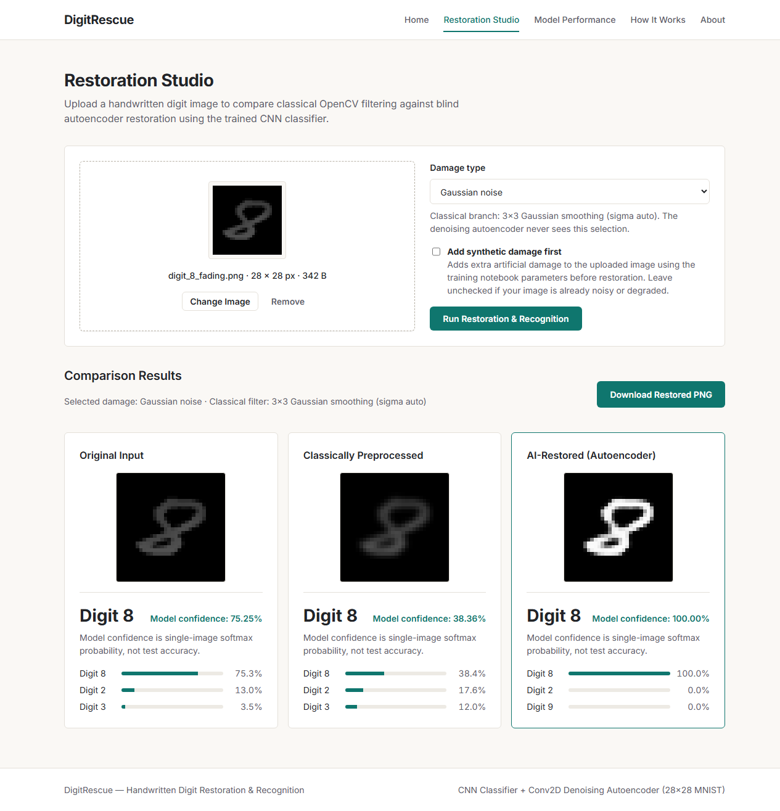

# DigitRescue

**Restore. Recognize. Recover.**

DigitRescue is a Flask web application for restoring and recognizing degraded 28x28 handwritten digits using two TensorFlow/Keras models: a convolutional denoising autoencoder (`digitrescue_autoencoder.keras`) and a convolutional digit classifier (`digitrescue_cnn.keras`).

## Features

- **Home (`/`)**: Project overview, a before-and-after strip generated directly from real MNIST test digits across all five corruption types, and a three-step pipeline summary.
- **Restoration Studio (`/restoration`)**: Drag-and-drop or browse PNG/JPG/JPEG uploads (up to 5 MB), choose a damage type (`Gaussian noise`, `Salt-and-pepper`, `Blur`, `Fading`, `Erasure`, or `Unknown`) for the classical OpenCV comparison branch, optionally apply synthetic corruption using the exact notebook parameters, compare **Original Input**, **Classically Preprocessed**, and **AI-Restored (Autoencoder)** side-by-side with top-3 softmax probabilities, and download the restored PNG (upscaled 10x with nearest-neighbor interpolation).
- **Model Performance (`/performance`)**: Reads CSV metrics exclusively from `results/` and displays held-out accuracy (`10,000` MNIST test images), PSNR comparisons, and autoencoder training/validation loss curves via locally served Chart.js (`static/js/chart.umd.min.js`). Missing records are displayed explicitly as `Not recorded`.
- **How It Works (`/how-it-works`)**: Hand-built SVG pipeline diagram and stage-by-stage technical breakdown matching the training notebooks.
- **About (`/about`)**: Problem statement, objectives, methodology, stack, applications, and future scope.

## Restoration Studio Screenshot



## Setup on Windows

```powershell
# 1. Clone and open the repository
git clone https://github.com/manjunath-2007/DigitRescue.git
cd DigitRescue

# 2. Create and activate a virtual environment
python -m venv venv
.\venv\Scripts\Activate.ps1

# 3. Install pinned dependencies
pip install -r requirements.txt

# 4. Start the Flask server
python app.py
```

Open `http://127.0.0.1:5000` in your browser. Health check endpoint: `http://127.0.0.1:5000/health`.

## Running Tests

```powershell
pytest -v tests/test_app.py
```

## Project Structure

```text
DigitRescue_Final_Project/
  app.py                                  # Flask application, upload validation, API & download routes
  pipeline.py                             # Model loading, OpenCV normalization, corruption & inference
  requirements.txt                        # Pinned Python dependencies
  README.md
  .gitignore
  models/
    digitrescue_cnn.keras                 # Trained Conv2D digit classifier
    digitrescue_autoencoder.keras         # T4-retrained Conv2D denoising autoencoder
  results/
    accuracy_comparison.csv               # Noisy, Preprocessed, AI Restored accuracy (%)
    psnr_comparison.csv                   # Noisy vs Restored PSNR (dB)
    summary_metrics.csv                   # Clean CNN accuracy and test-set count (10,000)
    autoencoder_training_history.csv      # 20-epoch train/validation loss, MAE, MSE
  templates/
    base.html
    index.html
    restoration.html
    performance.html
    how_it_works.html
    about.html
  static/
    css/style.css
    js/script.js
    js/chart.umd.min.js
    fonts/                                # Self-hosted Inter woff2 fonts
    images/                               # Real MNIST before/after strip PNGs & Studio screenshot
  notebooks/
    DigitRescue_Autoencoder_Colab_T4.ipynb
  backups/
    digitrescue_autoencoder_collapsed.keras
  tests/
    test_app.py
```

## How `results/` Is Used

The `/performance` route reads only from CSV files inside `results/` at request time without estimating or recomputing missing values:

- `summary_metrics.csv`: Clean CNN accuracy (`99.19%`) and test-set size (`10,000`).
- `accuracy_comparison.csv`: Held-out test accuracy for each of the five corruption types across Noisy, Preprocessed, and AI Restored outputs.
- `psnr_comparison.csv`: Mean PSNR (dB) before and after autoencoder restoration.
- `autoencoder_training_history.csv`: Per-epoch training and validation binary cross-entropy loss and MAE.
- `cnn_training_history.csv` is not present in `results/`, so the CNN Training & Validation Loss section displays `Not recorded`.

## Known Limits

- **Single isolated digits (28x28)**: Both models expect a single handwritten digit (`0`–`9`) on a uniform background; multi-digit strings or cluttered backgrounds are not segmented.
- **28x28 vs. larger uploads**: 28x28 MNIST-style uploads pass directly to the models (inverted if white-background) without cropping; larger images are thresholded with Otsu, cropped, and centered into a 20x20 box inside 28x28.
- **Model confidence vs. accuracy**: Softmax probability (`Model confidence`) reflects per-image score distribution, not calibrated accuracy on out-of-distribution inputs.
- **In-memory downloads**: Restored PNG download tokens are held in a bounded in-memory cache (last 64 requests) and expire when the server restarts.
